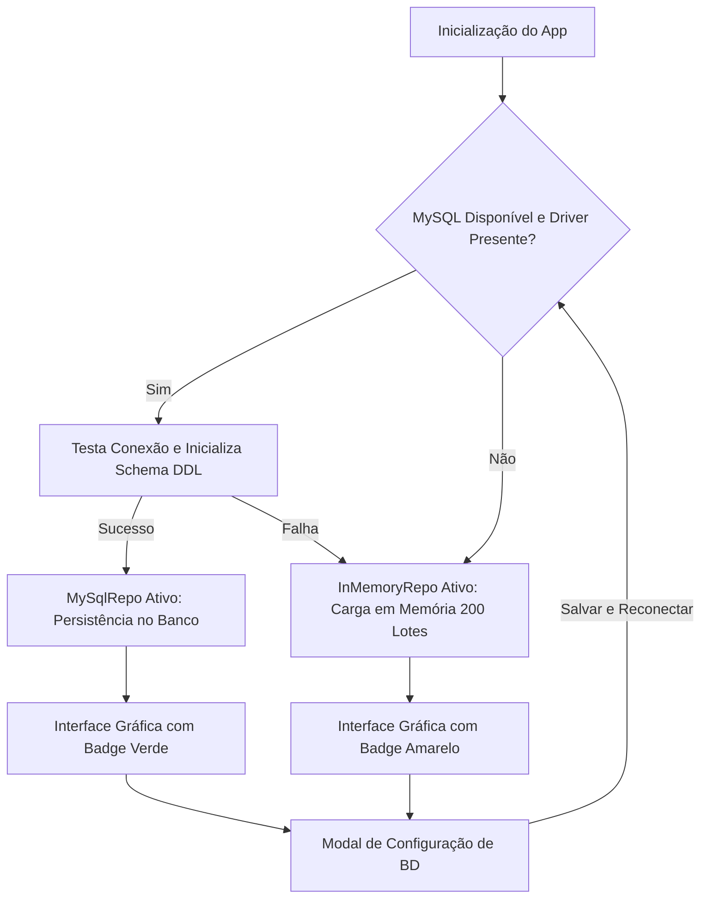

# PharmaStock — Sistema de Controle Farmacêutico

Sistema desktop em Java para gestão de estoque hospitalar e drogaria com foco em **conformidade sanitária FEFO** (*First Expired, First Out*), alta performance em ordenação de lotes, resiliência de banco de dados híbrido (MySQL com fallback transparente em memória) e interface gráfica moderna acelerada por Java 2D com micro-animações.

---

## 1. Visão Geral e Propósito

No setor farmacêutico, o gerenciamento de estoque não pode seguir o modelo tradicional FIFO (*First In, First Out*), pois a data de entrada do produto na farmácia é irrelevante frente ao prazo de validade determinado pela indústria química. 

O **PharmaStock** implementa estritamente a metodologia **FEFO**:
* **Prioridade Absoluta:** O medicamento cujo lote vence mais cedo deve ser dispensado primeiro.
* **Redução de Desperdício:** Elimina perdas financeiras por expiração de prateleira.
* **Segurança do Paciente:** Evita que produtos com data de expiração crítica fiquem esquecidos no fundo do armazém.

O sistema opera de forma autônoma: se houver um banco de dados MySQL ou HeidiSQL disponível, ele conecta e cria as tabelas automaticamente; se não houver conexão, ele assume instantaneamente uma lista em memória populada com 200 lotes e catálogo completo de medicamentos.

---

## 2. Estrutura Enxuta do Projeto

O projeto foi refatorado e enxugado para **9 arquivos Java essenciais** no diretório `src/`, sem dependências externas complexas além do driver JDBC nativo:

```
ControleFamarceutico/
├── PharmaStock.jar                     # Executável autocontido (duplo clique)
├── db.properties                       # Parâmetros de conexão persistidos
├── lib/
│   └── mysql-connector-j-8.3.0.jar     # Driver JDBC oficial
├── bin/                                # Classes compiladas
└── src/
    ├── Main.java                       # Ponto de entrada (Bootstrap Swing)
    ├── model/
    │   ├── Lote.java                   # Domínio de Lote, Medicamento e Fornecedor
    │   └── HistoricoMovimentacao.java  # Registro de auditoria de operações
    ├── database/
    │   └── DatabaseManager.java        # Conexão JDBC, auto-criação de schema e Config
    ├── repository/
    │   └── LoteRepository.java         # Interface, Factory, MySqlRepo e InMemoryRepo
    ├── service/
    │   └── HistoricoService.java       # Inteligência de negócio, KPIs e histórico 2026
    ├── sorting/
    │   └── AlgoritmosOrdenacao.java    # Quick Sort, Merge Sort e Insertion Sort
    └── view/
        ├── TelaPrincipal.java          # Janela principal, UITheme, botões e modal de BD
        └── PainelDashboard.java        # Dashboard executivo, KPIs e gráficos animados
```

### Responsabilidades por Módulo

| Arquivo | Camada | Descrição e Padrões Aplicados |
| :--- | :--- | :--- |
| `Main.java` | Entry Point | Inicializa a aplicação na *Event Dispatch Thread* (`SwingUtilities.invokeLater`). |
| `model/Lote.java` | Model / DTO | Entidade de lote com implementação de `Comparable<Lote>` (regra FEFO) e estruturas internas `Medicamento` e `Fornecedor`. |
| `model/HistoricoMovimentacao.java` | Model / Audit | Registro imutável de movimentações (Entrada, Venda/Saída, Descarte) com mês e data. |
| `database/DatabaseManager.java` | Infraestrutura | Gerenciador estático JDBC com classe interna `Config`, persistência em `db.properties` e DDL automatizado. |
| `repository/LoteRepository.java` | Persistência | Padrão *Repository* com `Factory` embutida, implementações `MySqlRepo` e `InMemoryRepo`. |
| `service/HistoricoService.java` | Serviço / Negócio | Cálculo de KPIs operacionais, agregação mensal e geração de histórico retroativo de Janeiro a Outubro de 2026. |
| `sorting/AlgoritmosOrdenacao.java` | Algoritmos | Métodos estáticos puros para algoritmos de ordenação e classes de compatibilidade. |
| `view/TelaPrincipal.java` | Apresentação | Janela mestre, tabela com paginação e busca, `UITheme`, `BotaoAnimado` e `DialogoConexaoBD`. |
| `view/PainelDashboard.java` | Apresentação | Painel analítico com gráficos vetoriais de barras mensais e ranking Top 5 com curvas de easing. |

---

## 3. Regra de Negócio: Ordenação FEFO (*First Expired, First Out*)

A ordenação FEFO é implementada na classe `model.Lote` através da interface `Comparable<Lote>`:

```java
@Override
public int compareTo(Lote outro) {
    int compData = this.dataValidade.compareTo(outro.dataValidade);
    if (compData != 0) {
        return compData; // O lote com menor data de validade vem primeiro
    }
    return Integer.compare(this.idLote, outro.idLote); // Desempate determinístico
}
```

Toda vez que um novo lote é adicionado, importado de CSV ou tem sua quantidade alterada, o método `aplicarOrdenacaoFEFO()` reorganiza o inventário com complexidade $O(N \log N)$ antes de atualizar a visualização em tabela.

---

## 4. Algoritmos de Ordenação e Laboratório de Benchmark

O módulo `sorting.AlgoritmosOrdenacao` reúne 3 algoritmos clássicos para estudo comparativo:

### 1. Quick Sort com Mediana de 3
* **Estratégia:** Seleciona a mediana entre o primeiro, o elemento central e o último elemento como pivô, evitando o pior caso $O(N^2)$ em vetores já quase ordenados.
* **Complexidade:** Média e Melhor caso $O(N \log N)$, Pior caso $O(N^2)$.
* **Uso no Sistema:** Algoritmo oficial de ordenação em tempo real do estoque.

### 2. Merge Sort
* **Estratégia:** Divisão e conquista estável (*stable sort*). Divide recursivamente o vetor ao meio e intercala os subvetores ordenados.
* **Complexidade:** Garantido $O(N \log N)$ em todos os cenários.
* **Memória:** Requer $O(N)$ de memória auxiliar temporária.

### 3. Insertion Sort
* **Estratégia:** Inserção direta elemento a elemento.
* **Complexidade:** $O(N)$ no melhor caso (quase ordenado), $O(N^2)$ no caso médio e pior caso.

### Laboratório de Benchmark Integrado
Na terceira aba da aplicação, o usuário pode selecionar lotes sintéticos gerados aleatoriamente (1.000, 5.000, 10.000, 50.000 ou 100.000 elementos) e disparar o benchmark. O sistema mede o tempo com `System.nanoTime()` e exibe uma tabela comparativa direta de tempo em milissegundos.

---

## 5. Arquitetura de Banco de Dados Resiliente (Híbrida)

O PharmaStock adota um padrão de **tolerância a falhas offline-first**:



### Auto-Criação de Tabelas (DDL Automático)
Ao conectar no MySQL (na porta `3306`, usuário `root`), o sistema executa:
1. `CREATE DATABASE IF NOT EXISTS controle_farmaceutico;`
2. `CREATE TABLE IF NOT EXISTS lotes (...)`
3. `CREATE TABLE IF NOT EXISTS historico_movimentacoes (...)`

### Modal de Configuração em Tempo de Execução
No botão **"Configurar BD"** do topo da janela, é possível reconfigurar Host, Porta, Nome do Banco, Usuário e Senha, testar a conectividade em tempo real e reconectar sem fechar o sistema. As configurações são salvas em `db.properties`.

---

## 6. Painel de Indicadores e Histórico Analítico (Dashboard)

A segunda aba da aplicação contém um centro de controle gerencial construído sob medida com Java 2D:

### KPIs Operacionais em Tempo Real
* **Dispensação Total:** Quantidade de caixas vendidas/dispensadas no período acumulado.
* **Conformidade FEFO:** Percentual de saídas realizadas respeitando o lote mais próximo da validade.
* **Total Recebido:** Unidades adicionadas no estoque através de compras e fornecedores.
* **Pico Operacional:** Identificação automática do mês com maior movimentação no ano.

### Visualizações Gráficas
1. **Gráfico de Barras Mensais (Jan a Out):** Colunas comparativas azuis (Entradas) e verdes (Dispensações) mês a mês.
2. **Ranking Top 5 Medicamentos Mais Dispensados:** Barras de progresso proporcionais aos produtos mais demandados no balcão.
3. **Auditoria com Filtro Mensal:** Tabela detalhada de cada registro de entrada, saída ou descarte com seletor de mês.

---

## 7. Design System e Micro-Animações

A interface foi projetada seguindo padrões modernos de design:

* **Paleta de Cores Curada:**
  * Fundo da Aplicação: `#F8FAFC` (Slate 50)
  * Cartões e Superfícies: `#FFFFFF` com bordas `#E2E8F0` (Slate 200)
  * Texto Primário: `#0F172A` (Slate 900) e Secundário: `#64748B` (Slate 500)
  * Destaques de Status: Verde `#10B981` (Regular/Sucesso), Laranja `#F59E0B` (Atenção), Vermelho `#EF4444` (Vencido).
* **Sombras Suaves:** Renderização em Java 2D com gradiente de opacidade para simular elevação e profundidade.
* **Curvas de Easing (Inspiradas no GSAP):**
  * O método `UITheme.easeOutPower2(t)` ($1.0 - (1.0 - t)^2$) é utilizado para animar o hover dos botões e o crescimento fluido das barras nos gráficos durante 400 milissegundos.

---

## 8. Funcionalidades de Balcão e Operação Diária

* **Cadastro de Novo Lote:** Formulário rápido com validação de datas no formato `DD/MM/AAAA`.
* **Filtro Rápido em Tempo Real:** Campo de busca que filtra os lotes instantaneamente à medida que o usuário digita.
* **Registrar Venda / Saída de Caixa:** Diálogo para dispensação fracionada ou total de caixas de um lote, com dedução de saldo e gravação no histórico.
* **Importação e Exportação CSV:** Permite importar inventários externos e exportar o estoque atual em arquivo CSV compatível com Excel e LibreOffice.
* **Alertas Visuais de Validade:** A tabela categoriza os produtos automaticamente em:
  * `Regular` (verde)
  * `Vence em breve` (laranja — menos de 45 dias para vencer)
  * `VENCIDO` (vermelho)

---

## 9. Como Executar a Aplicação

### Opção 1: Executável JAR (Recomendado)
Dê um duplo clique no arquivo:
* **`PharmaStock.jar`** (localizado na pasta raiz ou na subpasta do projeto)

Ou via terminal:
```powershell
java -jar PharmaStock.jar
```

### Opção 2: Compilação e Execução via Terminal a partir do Código-Fonte
No diretório `ControleFamarceutico/`:

```powershell
# 1. Compilar os 9 arquivos para a pasta bin
javac -encoding UTF-8 -cp "lib/*;src" -d bin src/model/*.java src/database/*.java src/repository/*.java src/service/*.java src/sorting/*.java src/view/*.java src/Main.java

# 2. Executar a classe principal Main
java -cp "bin;lib/*" Main
```

---

## 10. Requisitos de Ambiente

* **Java Runtime / JDK:** Versão 17 ou superior (testado e validado em OpenJDK 25).
* **Banco de Dados (Opcional):** MySQL Server 8.0+ ou MariaDB / HeidiSQL na porta padrão 3306.
* **Sistema Operacional:** Windows 10/11, Linux ou macOS.
